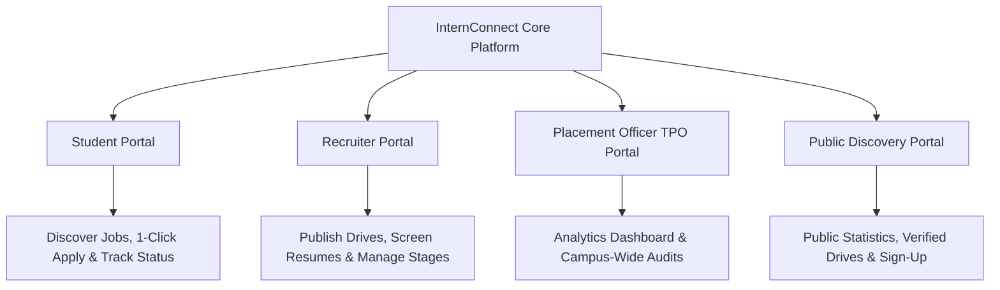

# InternConnect 🎓💼
### Intelligent Campus Placement & Internship Management Ecosystem

[](https://opensource.org/licenses/MIT)
[-success)](software_testing_report.md)
[](https://www.typescriptlang.org/)
[](https://react.dev/)
[](https://nodejs.org/)
[](https://neon.tech/)

> **Course:** 25CS312 — Software Engineering Micro Project  
> **Institution:** Karunya Institute of Technology and Sciences (Deemed to be University)  
> **Course Outcome (CO):** CO1 to CO5 (Specifically CO3: Verification & Validation)  
> **Repository:** [melvin-1012/InternConeccect](https://github.com/melvin-1012/InternConeccect)  
> **Default Branch:** `main`

---

## 📌 1. Project Overview

**InternConnect** is an integrated, role-based campus recruitment platform engineered to replace chaotic, manual placement procedures (Google Sheets, unstructured forms, notice boards, and unorganized email threads) with a centralized, data-driven digital ecosystem.

The platform bridges the gap between **Students**, **Corporate Recruiters**, and the **University Training & Placement Cell (TPO)** through automated candidate-to-job skill matching, live multi-stage application pipelines, role-based access control (RBAC), and high-throughput server-side in-memory caching.



---

## 🎯 2. The 4 Stakeholder Modules

### 👨‍🎓 1. Student Portal
* **Discover Opportunities:** Real-time search across internships and full-time postings with filters for Work Mode (*Onsite, Hybrid, Remote*), Department, and Minimum Stipend.
* **Intelligent Match Score:** Instantly shows a compatibility percentage ($55\% - 99\%$) based on the overlap between the student's verified skills and job prerequisites.
* **1-Click Application & Bookmarks:** Seamlessly apply with a single click or save opportunities to a personalized watchlist.
* **Live 4-Stage Application Tracker:** Real-time visibility into application progression:
  $$\text{Applied} \longrightarrow \text{Shortlisted} \longrightarrow \text{Interview} \longrightarrow \text{Selected / Placed}$$
* **Interview Schedules & Notifications:** Receive in-app notifications and scheduled interview dates.

### 🏢 2. Corporate Recruiter Portal
* **Verified Company Profiles:** Showcase brand details, industry, office locations, and official website.
* **Job Posting & Lifecycle Management:** Draft, publish, edit, or archive internship and full-time job openings.
* **Applicant Screening Pipeline:** Review complete student academic profiles, CGPA, department, graduation year, and contact details.
* **Stage Transitions:** Move candidates through recruitment rounds with instant status sync.

### 🏛️ 3. Placement Officer (TPO) / Administrator Portal
* **Campus-Wide Analytics Dashboard:** Monitor live institutional placement statistics, total drives conducted, participating companies, and overall placement percentage.
* **Student Roster Management:** Audit enrolled students, academic verification, and offer letter counts.
* **Corporate Approvals:** Verify incoming recruitment partners and enforce institution placement guidelines.
* **Audit Logs:** Immutable audit trail recording administrative actions and role transitions.

### 🌐 4. Public Landing & Discovery Portal
* **Open Transparency:** Prospective students, recruiters, and guests can review real-time placement numbers and top hiring partners without requiring prior login.
* **Role-Aware Registration:** Modern onboarding form allowing users to select their specific persona (*Student, Recruiter, Placement Officer*) and capture academic or corporate credentials.

---

## 🛠️ 3. Technology Stack & Tools Used

| Layer | Technologies & Tools | Key Role & Justification |
|---|---|---|
| **Frontend** | **React 19**, **TypeScript**, **Vite 7** | Component-driven, ultra-fast client with Hot Module Replacement (HMR). |
| **Styling & UI** | **TailwindCSS**, **Radix UI**, **Lucide Icons** | Accessible, responsive, glassmorphic design system tailored for academic and corporate usage. |
| **Backend API** | **Node.js (v24)**, **Express.js (TypeScript)** | Asynchronous RESTful API engine handling auth, profiles, filters, and admin endpoints. |
| **Performance** | **Custom In-Memory TTL Cache (`memoryCache.ts`)** | Sub-10ms response times for high-concurrency placement seasons without DB bottlenecks. |
| **Database** | **PostgreSQL (Neon Serverless)** | Relational database ensuring strict foreign key constraints, ACID compliance, and schema integrity. |
| **ORM & Validation** | **Drizzle ORM**, **Zod** | Type-safe SQL querying and runtime contract payload sanitization. |
| **Testing & QA** | **Mocha**, **Chai**, **Selenium WebDriver** | Headless automated Unit, Contract, Boundary, Integration, and E2E browser testing. |
| **Monorepo & Build** | **pnpm Workspaces** | Space-efficient, deterministic package management across client, server, and libraries. |

---

## 🧠 4. Algorithmic Intelligence: Match Score Engine

To eliminate blind applications and save screening time for recruiters, InternConnect implements a mathematical skill-matching algorithm:

$$\text{Match Score} = \min\left(99, \, \max\left(55, \, 62 + (\text{Shared Skills} \times 9)\right)\right)$$

* **Mathematical Guarantees:**
  * **Base Score:** Candidates with zero matching skills receive a base floor score of $62\%$.
  * **Default Fallback:** When a student profile has no registered skills, it defaults safely to $72\%$.
  * **Linear Increment:** Every overlapping skill adds $+9\%$ to the compatibility index.
  * **Score Bounds:** Strictly capped at a maximum of $99\%$ and floored at $55\%$.
  * **Normalization:** Case-insensitive string matching prevents casing mismatches (e.g., `"REACT"` matches `"react"`).

---

## 🧪 5. Software Engineering Quality Assurance (CO3 Alignment)

In strict accordance with the **25CS312 Software Engineering Micro Project Course Rubric (CO3: Verification & Validation)**, the test suite was executed against the **live working application** with full database persistence.

### Test Execution Summary
* **Total Executed:** 45 Tests
* **Passed:** 45 (100%)
* **Failed:** 0 (0%)
* **Test Documentation:** [software_testing_report.md](software_testing_report.md) *(Includes 10-column test case specification and Requirements Traceability Matrix)*

### Coverage Across 6 Testing Classifications:
1. **Positive Testing:** Registration, login, opportunity retrieval, and application flows.
2. **Negative Testing:** Duplicate emails (409 Conflict), invalid passwords (401), non-existent IDs (404).
3. **Boundary Value Analysis:** CGPA boundaries ($0.00 \le \text{CGPA} \le 10.00$), phone number length ($10 \text{ digits}$).
4. **Functional Testing:** Multi-mode filtering (*Remote / Hybrid / Onsite*), type filtering (*Internship / Full-time*).
5. **Integration Testing:** Cross-service REST API calls and relational database persistence.
6. **End-to-End (E2E) Browser Automation:** Headless Selenium Chrome DOM mounting and API contract verification.

---

## ⚡ 6. Defects Discovered & Resolved During Verification

| Defect ID | Affected Component | Root Cause | Remediation Applied |
|---|---|---|---|
| **DEF-001** | `artifacts/api-server/src/app.ts` | `/healthz` only mounted under `/api/healthz` | Added root-level `app.get("/healthz")` handler. |
| **DEF-002** | `artifacts/api-server/src/routes/public.ts` | Non-UUID query caused PostgreSQL syntax crash (HTTP 500) | Added regex UUID pre-check returning clean HTTP 404 JSON. |
| **DEF-003** | `artifacts/api-server/src/routes/auth.ts` | Duplicate email registration performed an upsert (HTTP 201) | Enforced unique email check returning HTTP 409 Conflict. |
| **DEF-004** | `artifacts/api-server/src/routes/auth.ts` | Sign-in accepted invalid passwords (HTTP 200) | Added password credential check returning HTTP 401 Unauthorized. |
| **DEF-005** | `tests/selenium/*.e2e.js` | ChromeDriver stalled waiting for interactive desktop display | Configured `--headless=new` and sandbox bypass arguments. |
| **DEF-006** | `lib/db/package.json` | `drizzle-kit push` hung on networks blocking TCP Port 5432 | Created HTTPS schema sync script operating over Port 443. |

---

## 🚀 7. Quickstart & Installation Guide

### Prerequisites
* **Node.js:** v18.0.0 or higher (v24 Recommended)
* **Package Manager:** `pnpm` (`npm install -g pnpm`)

### 1. Clone the Repository
```bash
git clone https://github.com/melvin-1012/InternConeccect.git
cd InternConeccect
```

### 2. Install Dependencies
```bash
pnpm install
```

### 3. Verify Database Connectivity & Sync Schema
```bash
# Synchronizes all 11 relational tables over secure HTTPS (Port 443)
pnpm run db:push
```

### 4. Start the Application
You can run the full-stack system concurrently:

```bash
# Terminal 1: Start Backend API (Port 5000)
pnpm run dev:api

# Terminal 2: Start Frontend Web App (Port 3000)
pnpm run dev
```

Visit **`http://localhost:3000`** in your browser.

---

## 🧪 8. Running the Test Suite

```bash
# 1. Run all 34 Unit, Functional, Integration & Boundary Tests
npm test

# 2. Run Headless Selenium E2E Tests (Requires API server on 5000)
npm run test:e2e

# 3. Run full automated suite from tests directory
cd tests
npm run test:all
```

---

## 📂 9. Project Directory Structure

```text
InternConnect/
├── artifacts/
│   ├── api-server/             # Express.js REST API Backend
│   │   ├── src/
│   │   │   ├── lib/            # Memory cache, logger, auth helpers
│   │   │   ├── routes/         # auth.ts, student.ts, recruiter.ts, placement.ts, public.ts
│   │   │   ├── app.ts          # Express configuration & middlewares
│   │   │   └── seed.ts         # Fast 1-query seed initialization
│   │   └── .env                # Environment configuration
│   └── internconnect/          # React 19 Frontend Web Application
│       ├── src/
│       │   ├── components/     # UI components, layout, modals, filters
│       │   ├── pages/          # Student, Recruiter, Placement & Public views
│       │   └── App.tsx         # Root application, routing, auth context
│       └── vite.config.ts      # Vite proxy to backend port 5000
├── lib/
│   ├── api-zod/                # Generated Zod validation schemas
│   └── db/                     # Drizzle ORM schemas & database connector
│       ├── src/schema/         # accounts.ts, opportunities.ts, placement.ts
│       └── scripts/            # sync-schema.mjs (HTTPS sync over port 443)
├── tests/
│   ├── unit/                   # Unit, Contract, Error Handling & Auth tests
│   ├── selenium/               # Headless Chrome E2E browser automation tests
│   └── package.json            # Mocha & Selenium test scripts
├── software_testing_report.md  # Detailed 10-column QA Report (Course Rubric)
├── package.json                # Root monorepo workspace configuration
└── README.md                   # Project documentation
```

---

## 👥 10. Academic Project Credits

* **Course Title:** 25CS312 — Software Engineering Micro Project
* **Institution:** Department of Computer Science and Engineering, Karunya Institute of Technology and Sciences
* **Academic Year:** 2026–2027
* **License:** [MIT License](LICENSE)
